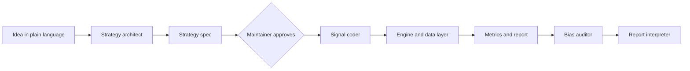

# Roadmap

This document is the source of truth for how `backtest-agent` is built. Every phase is one branch and one pull
request. Claude Code reads this file at the start of each phase.

## Project overview

**backtest-agent** is an AI-assisted backtesting tool for trading strategies. You describe a strategy in plain
language. Claude subagents turn it into a validated strategy spec and a small signal function, a deterministic and
tested engine runs it on historical data, and an independent auditor agent checks the result for look-ahead bias,
survivorship bias, missing costs and overfitting before an honest verdict is written.

The project is educational and not investment advice.

### Guiding principles

1. **The LLM never writes the engine.** The data layer, engine and metrics are deterministic, tested Python code.
   Agents only turn ideas into a strategy spec and a small signal function, then review and interpret results.
2. **Look-ahead is impossible by default.** The engine shifts signals by at least one bar before executing them. A
   spec has to opt out explicitly, and every report shows that fact.
3. **Human approval gate.** The agent writes a strategy spec, and nothing runs until the maintainer approves it.
4. **Every run is logged.** Spec, data hash, code version and results are stored. Reports state how many variants
   of a strategy were tried, so an overfitted result can be told apart from a real one.
5. **Tests ship with the feature.** A feature is done when code, tests, docs and its status in this file are updated.
6. **Public repo hygiene.** No market data, run outputs, keys or `.env` files are ever committed.

### Building blocks

| Block | Responsibility | Planned location |
|---|---|---|
| Data layer | Provider interface, yfinance provider, Parquet cache, validation, data hash | `src/backtest_agent/data/` |
| Strategy spec | Pydantic schema for YAML specs, signal interface, example strategies | `src/backtest_agent/spec/`, `strategies/` |
| Engine | Vectorized daily backtest, long-only, multi-asset, costs and slippage | `src/backtest_agent/engine/` |
| Metrics | Performance and risk metrics, benchmark comparison | `src/backtest_agent/metrics/` |
| Reporting | Markdown and HTML reports with charts and caveats | `src/backtest_agent/reporting/` |
| Journal | Run log with trial counter per strategy family | `src/backtest_agent/journal/` |
| CLI | The `bt` command | `src/backtest_agent/cli.py` |
| Agents | Strategy architect, signal coder, bias auditor, report interpreter, `/backtest` command | `.claude/` |
| Robustness | Out-of-sample, walk-forward, sensitivity, regimes, look-ahead test, deflated Sharpe | `src/backtest_agent/robustness/` |

Feature IDs (`F-01` to `F-27`) are stable references. Use them in PR descriptions and in the commit body, for example
`feat(engine): add vectorized portfolio engine (F-09)`.

### Tech stack

Python 3.12 managed with `uv`, `ruff` for linting and formatting, `pytest` for tests, `pandas` and `numpy` for the
engine, `pydantic` v2 and `PyYAML` for specs, `yfinance` for the first data provider, `pyarrow` for the Parquet
cache, `matplotlib` for report charts, `typer` for the CLI, GitHub Actions for CI, Claude Code subagents and skills
for the agent layer. Final library choices are made in the plan of the phase that first needs them and recorded as
an ADR when they matter.

## Architecture

The agents sit around a deterministic core. Details live in [architecture.md](architecture.md), the reasons behind
the design in [adr/README.md](adr/README.md).

## Working agreement

- The project language is English: code, commits, docs, README and the chat about the project.
- The work happens in two places. In the chat, Claude plans each step and hands over a Claude Code prompt and the
  PowerShell commands for it. In the terminal, the maintainer runs them on Windows with PowerShell and Claude Code.
- One phase at a time, in order. A phase starts only after the previous one is merged.
- Claude Code starts each phase in Plan Mode, and the maintainer reviews the plan before any code is written.

## How to resume

Use this when a session has lost its context:

1. Read `CLAUDE.md` and this file.
2. Check where the repo stands: `git switch main; git pull; git log --oneline -10; gh pr list`.
3. The current phase is the first one in the table below that is not **Done**, or the one whose pull request is
   not merged yet. The status is set to **Done** in the phase's own pull request, so a phase marked **Done** on a
   branch that is not merged is still the current one. If its branch or pull request already exists, continue there
   instead of starting over.
4. Do not skip phases and do not start the next one before the current one is merged. If a phase is split into
   parts and the branch of the next part does not exist yet, create it from `main` and continue with the next open part.
5. Set the phase to **Done** in the table below and in the README roadmap status as part of the phase's own pull
   request, not after the merge. Record every deviation from this plan under "Deviations from the plan".

## Git workflow

- **`main` is protected.** No direct pushes. Changes arrive via pull request, CI must be green.
- **One branch per phase**, short-lived, created from `main`.
- **Squash merge.** Every PR becomes one clean commit on `main`; the branch is deleted afterwards.
- **Small PRs.** Two manageable pull requests are better than one huge one.

| Prefix | Used for | Example |
|---|---|---|
| `feature/` | New functionality | `feature/core-engine` |
| `fix/` | Bug fix | `fix/benchmark-dates` |
| `docs/` | Documentation only | `docs/roadmap` |
| `chore/` | Setup, CI, dependencies | `chore/repo-setup` |

**Commits** follow [Conventional Commits](https://www.conventionalcommits.org/): `feat`, `fix`, `docs`, `test`, `chore`
(for example `feat(engine): add vectorized portfolio engine`).

**Versions** follow [Semantic Versioning](https://semver.org/) and are published as a Git tag with a GitHub release,
see [RELEASING.md](RELEASING.md): `v0.1.0` after Phase 9 (a working command-line backtester), `v0.2.0` after
Phase 12 (the agent workflow), `v1.0.0` after Phase 15 (robustness checks and the deflated Sharpe ratio).

**Language:** English for code, commits, documentation and the README.

### Routine for each phase

1. Create the branch: `git switch main; git pull; git switch -c <branch>`
2. Explore and plan: start Claude Code in Plan Mode, review the plan before any code is written.
3. Code: implement the plan, review intermediate steps, steer when needed.
4. Verify: `uv run pytest`, `uv run ruff check .`, `uv run ruff format --check .`, tick off the acceptance criteria.
5. Commit and open a PR: conventional commit, PR description, CHANGELOG entry under "Unreleased". Set the phase to
   **Done** in the phases table and in the README roadmap status in this same PR.
6. Merge: CI green, squash merge, delete the branch, update local `main`.

### Definition of Done

- **Works:** all acceptance criteria of the phase are met and checked by hand.
- **Tested:** new logic has tests; CI is green.
- **Clean:** the linter reports nothing; no secrets and no generated files in the commit.
- **Documented:** README or `docs/` are updated, the CHANGELOG has an entry.
- **CLAUDE.md current:** new commands and conventions are in the project memory.
- **Merged:** pull request squash-merged into `main`, branch deleted.

## Phases at a glance

Effort is a rough guess with Claude Code: S is one or two hours, M is half a day, L is about a day.

| Phase | Branch | Result | Features | Effort | Status |
|---|---|---|---|---|---|
| 0 | `chore/repo-setup` | Project skeleton, CI, CLAUDE.md, template placeholders filled | F-01, F-02, F-03 | M | Done |
| 1 | `feature/data-provider` | Provider interface, yfinance provider, Parquet cache | F-04, F-05 | M | Done |
| 2 | `feature/data-validation` | Data checks and a reproducibility hash | F-06 | S | Done |
| 3 | `feature/strategy-spec` | YAML strategy spec, signal interface, example strategies | F-07, F-08 | M | Done |
| 4 | `feature/core-engine`, `feature/engine-runner` | Engine with execution delay, proven by hand-calculated tests (two parts) | F-09, F-11 | L | Done |
| 5 | `feature/costs-slippage`, `feature/costs-results` | Commission, spread and slippage models (two parts) | F-10 | M | Done |
| 6 | `feature/metrics-benchmark` | Performance metrics and buy-and-hold comparison | F-12, F-13 | M | Planned |
| 7 | `feature/report` | Markdown and HTML report with charts and caveats | F-14 | M | Planned |
| 8 | `feature/experiment-journal` | Run log with trial counter | F-15 | S | Planned |
| 9 | `feature/cli` | `bt` command; release `v0.1.0` | F-16 | M | Planned |
| 10 | `feature/agents-architect-coder` | Strategy architect and signal coder subagents | F-17, F-18 | M | Planned |
| 11 | `feature/agents-auditor-interpreter` | Bias auditor and report interpreter subagents | F-19, F-20 | M | Planned |
| 12 | `feature/backtest-command` | `/backtest` command with approval gate; release `v0.2.0` | F-21 | M | Planned |
| 13 | `feature/oos-walkforward` | Out-of-sample split and walk-forward analysis | F-22, F-23 | L | Planned |
| 14 | `feature/sensitivity-regimes` | Parameter sensitivity and market regime analysis | F-24, F-25 | M | Planned |
| 15 | `feature/lookahead-deflated-sharpe` | Automated look-ahead test and deflated Sharpe ratio; release `v1.0.0` | F-26, F-27 | M | Planned |

### Deviations from the plan

- Phase 0: `src/backtest_agent/cli.py`, `strategies/` and `.claude/` are not created yet; they need runtime
  dependencies or belong to later phases (Phases 3, 9 and 10). Merged as PR #2.
- Phase 0: CI pins `astral-sh/setup-uv@v10.3.0` because the action publishes no floating major tag.
- Phase 0: branch protection for `main` is documented in `CONTRIBUTING.md` but has to be enabled by the maintainer
  in the GitHub settings; the green run of a test PR on both operating systems is checked when this PR is opened.
- Phase 1: the cache is a separate wrapper, `CachedProvider`, which works with any provider, instead of a part of the
  yfinance provider. Requests whose end date is today or later are never cached (partial bar of the current day).
  The cache has no expiry; `refresh=True` re-downloads.
- Phase 1: ADR 0003 (standard price frame, adjusted prices, caching as a wrapper) was added, and `pyproject.toml`
  excludes tests marked `network` by default (`addopts = "-m 'not network'"`). Merged as PR #3.
- Phase 2: the validation reports instead of raising and is `validate_prices` in `data/checks.py` (types in
  `data/validation.py`, hash in `data/hash.py`), not a change of `validate_standard_frame`, which keeps raising for
  format violations. NaN or zero volume is a warning or info, not an error, because the engine is price-based.
  Added beyond the roadmap list: the codes `no_data`, `non_finite_value` and `negative_volume`.
- Phase 2: calendar gaps use a dependency-free heuristic (missing business days between a symbol's own data dates,
  default limit 4) instead of an exchange calendar, so a single missing day is not detected. ADR 0004 (validation) and
  ADR 0005 (data hash) were added.
- Phase 2: "errors stop a run" is delivered as a mechanism (`ValidationResult.raise_for_errors`); the engine and CLI
  that call it before every run do not exist yet (Phases 4 and 9). Merged as PR #4.
- Phase 3: the spec is stricter than the roadmap list: `sizing`, `rebalance`, `benchmark`, `initial_capital` and
  every number of the `costs` block are required (only `description`, `data` and `execution` have defaults), unknown
  fields are rejected and `allow_same_bar_execution: true` with `delay_bars >= 1` is rejected as contradictory.
  `momentum_12_1` counts its windows in trading days (252 and 21), not calendar months.
- Phase 3: the signal contract gained `warmup_rows` (every params model declares the history its signal needs, the
  contract test checks that the declaration is honest) and a runtime check of every signal output
  (`Signal.generate`, `validate_signal_output`). Phases 4 and 9 got a task for loading history from `period.start`
  minus the warm-up. ADR 0006 (signal contract, where signals live) and ADR 0007 (strict, explicit spec) were added.
- Phase 4: the phase is split into two pull requests because it exceeds the size of one reviewable PR. Part 1
  (`feature/core-engine`): pure simulation (sizing, rebalance schedule, delay shift, cost hook, portfolio core), the
  hand-calculated fixtures, `docs/engine.md` and ADR 0008. Part 2 (`feature/engine-runner`): the runner and the
  result object, see "Part 2" in the Phase 4 section. Phase 4 is **Done** with part 2.
- Phase 4: the core is a **loop over bars with vector operations across symbols**, not a vectorized cumulative
  calculation, because cash, deferred orders and the cash constraint are path dependent and the loop is the form in
  which each rule can be read and checked (ADR 0008).
- Phase 4: beyond the roadmap text, the engine always takes an **initial decision** for the bar that executes on the
  first bar of the period (otherwise `weekly`, `monthly` and `on_signal` would sit in cash), carries orders of symbols
  without a price as **share quantities** to the next bar with a price, scales buys down when a deferred sale leaves
  too little cash, and reports `deferred_orders` and `unfilled_orders`. `equal_weight` splits capital among the
  selected symbols only (`signal / n`).
- Phase 4 part 2: `WarmupInfo` has more fields than the roadmap text: `first_decision_date` and
  `initial_target_weights` (what the first trade was based on, because the trimmed signals start on the first bar),
  `rows_before`, `first_data`, `short_symbols`, `buffer_days` and `fetch_start`. "Sufficient" means that every symbol
  has at least `warmup_rows` of its own trading rows strictly before the first decision bar. The signal runs before
  the `allow_short_warmup=False` check (the initial target weights need it), the raise happens before the simulation.
  `run_backtest` also raises `DataUnavailableError` for missing symbols or no bar on or after `period.start`, and
  `ValueError` for rows after `period.end`. `BacktestResult` compares by field (`eq=False`) and has no `to_dict` yet.
- Phase 4 part 2: found by the invariant tests through the runner: a symbol without a price on the **first bar** (a
  holiday of one symbol) made the core raise, because it did not know the closes of the warm-up bars. `simulate` got
  the optional argument `initial_last_close`, `simulate_signals` passes the last warm-up closes; the semantics only
  say now that "last close" includes bars before the first bar (fixture H15, ADR 0009). Part 1 tests are unchanged.
- Phase 4 part 2: the test signal of fixture H14 is registered per test with `monkeypatch` on the registry, because
  `test_builtin_signals.py` and `test_signal_contract.py` pin the registry to the three built-in signals.
- Phase 4 part 2: the invariant tests show that the core can fill float dust (a buy scaled down to the float residue
  of cash can fill about 1e-14 shares); the permutation test ignores trades below 1e-6 in notional. Documented
  deferred orders keep their share quantity (`docs/engine.md`).
- Phase 5: the phase is split into two pull requests because it would exceed one reviewable PR. Part 1
  (`feature/costs-slippage`): cost model, `costs.min_commission`, the funding and remainder rule in the core, the `cost`
  column and per-bar costs, fixtures H16 to H22, zero-cost equivalence, property tests, ADR 0010. Part 2
  (`feature/costs-results`): `run_backtest` wiring, gross and net result, flags, fixture H23, live test, status **Done**.
  Effort is M instead of S.
- Phase 5: `spread_bps` is the half-spread (it always was in the spec and in F-10) and is applied as written, without
  halving it again. The minimum fee is the optional field `costs.min_commission` (per trade, commission only, default
  0), not part of the three required numbers, so existing specs stay valid.
- Phase 5: beyond the roadmap text, the fee of a **sale is capped at its proceeds** (so a sale never brings in a
  negative amount), the funding rule solves the buy factor by bisection on the model's cost function, and the part of
  a buy that only the fees kept from being bought is dropped instead of staying pending (otherwise every rebalance to a
  fully invested target would inflate `deferred_orders`); with zero costs the Phase 4 behaviour is bit-identical
  (tested). The core raises `EngineInvariantError` for an invalid cost (negative, NaN, infinite) of a custom model.
  A portfolio ruined by fees has weights and turnover 0 instead of NaN.
- Phase 5: the third "Done when" bullet ("higher turnover with the same costs always means higher total costs") is not a
  theorem: costs are in currency and turnover is a ratio, and a minimum commission depends on the trade count. It is
  replaced by the claim that is tested exactly (see Phase 5 and ADR 0010).
- Phase 5 part 2: the result scalars (`total_costs`, `gross_final_equity`, `net_return`, `gross_return`, `cost_drag`,
  `cost_share`) are read-only properties derived from the stored `costs`, `gross_equity`, `equity` and `initial_equity`
  (the journal serializes them explicitly); `costs_applied` is True also for a spec whose costs are all 0; the twin is
  skipped, and `gross_equity` is a copy of `equity`, when no cost can be charged; `CostsSpec.is_zero` defines "all four
  numbers 0" once; ADR 0011 records the result decisions. Added beyond the Part 2 block: fixtures H23b (falling market,
  no cost share) and H23c (a portfolio ruined by fees). Existing tests that had to change: the risk-flag and
  H14 tests of `test_engine_runner.py` (H14 runs with `apply_costs=False`, its expected values are unchanged),
  `test_engine_examples.py`, and the buy-and-hold identity of `test_engine_invariants.py` (`apply_costs=False`).
  The Phase 4 entries of the CHANGELOG are reworded where they said that costs are not applied.
- Phase 5: one Phase 4 test was replaced, `test_a_cost_model_that_makes_cash_negative_is_an_invariant_error` in
  `tests/test_engine_core_invariants.py`. It tested the documented temporary behaviour (a 10 percent model makes cash
  negative until the funding rule is extended), which no longer exists; the new tests keep the guard with
  pathological models. No expected value of H1 to H15 changed.

---

## Phase 0: Repo setup

**Branch:** `chore/repo-setup` · **Goal:** a clean public repository in which every later phase only adds content.

Tasks:

- Fill in every double-curly-brace placeholder of the template in `README.md`, `CLAUDE.md`, `CONTRIBUTING.md`, `CHANGELOG.md`,
  `docs/RELEASING.md`, `docs/architecture.md` and `docs/adr/`, and remove sections that do not apply.
- F-01 Project skeleton: `pyproject.toml` with Python 3.12 and `uv`, src layout with the package `backtest_agent`,
  folders from the building blocks table, one smoke test, `ruff` and `pytest` configuration.
- `.gitignore` additions so market data and outputs never reach the public repo: `data/`, `runs/`, `reports/`,
  `*.parquet`, `.venv/`, `.env`.
- F-02 CI: adapt the template's GitHub Actions workflow so it runs `uv sync`, `ruff check`, `ruff format --check` and
  `pytest` on `ubuntu-latest` and `windows-latest` for every pull request.
- F-03 Claude Code context: complete `CLAUDE.md` (goal, stack, PowerShell-friendly commands, workflow, conventions).
- ADR 0001: own engine instead of vectorbt or backtrader. ADR 0002: deterministic core, the LLM never writes the engine.
- README: project pitch, quickstart skeleton and the disclaimer that the project is educational and not investment advice.
- Enable branch protection for `main` (require a pull request and a green CI) and document it in `CONTRIBUTING.md`.

Done when:

- A test PR triggers CI and it runs green on both operating systems.
- `uv sync` and `uv run pytest` work on a fresh clone.
- No template placeholder (double curly braces) is left anywhere in the repository.
- README, `CLAUDE.md` and `docs/ROADMAP.md` describe the goal and the process of the project.
- Every relative markdown link in `README.md` and `docs/` resolves.

## Phase 1: Data provider and cache

**Branch:** `feature/data-provider` · **Goal:** daily price data arrives in one standard format, from any provider.

Tasks:

- F-04 Abstract `DataProvider` interface: symbols, start, end in, standardized frame out (date index, adjusted OHLCV).
- F-05 yfinance provider with split and dividend adjusted prices and a Parquet cache under `data/cache/`.
- A fake provider with fixed in-memory data, so tests never touch the network.
- `docs/data.md`: the standard format, the adjustment rules and the data source caveats (yfinance is unofficial and for
  personal use, which is why data is never committed).

Done when:

- A request for three tickers returns the standard frame; a second identical request is served from the cache.
- The test suite and CI run without network access.
- `git check-ignore` confirms that cached data is not tracked.

## Phase 2: Data validation

**Branch:** `feature/data-validation` · **Goal:** bad data is caught before it can produce a pretty but wrong result.

Tasks:

- F-06 Validation checks: duplicate or unsorted dates, gaps against the trading calendar, NaN values, non-positive
  prices, extreme daily moves, stale prices and likely split artifacts.
- A validation result with severities (info, warning, error); errors stop a run, warnings appear in the report.
- A data hash (SHA-256 of the canonical frame) so every result can be tied to the exact data it used.

Done when:

- Tests with deliberately corrupted frames show that each check fires.
- Identical data always gives the same hash, and a single changed value gives a different one.

## Phase 3: Strategy spec and signal interface

**Branch:** `feature/strategy-spec` · **Goal:** a strategy is a validated YAML file plus one small, well-defined function.

Tasks:

- F-07 Pydantic schema for the spec: `schema_version`, name, universe, period, data source, signal id and params,
  execution (`delay_bars` default 1, price rule open or close), sizing, rebalancing, costs, benchmark, initial capital.
- A spec with `delay_bars: 0` is rejected unless it explicitly sets `allow_same_bar_execution: true`; the report
  always flags it.
- F-08 Signal interface `generate_signals(prices, params) -> DataFrame` with a registry, so the engine finds
  strategies by id.
- Example strategies in `strategies/`: SMA crossover, 12-1 momentum and buy-and-hold.
- `docs/strategy-spec.md` describing every field.

Done when:

- Valid YAML files load into spec objects; invalid ones produce readable error messages that name the field.
- The three examples validate and their signal functions pass an interface test.

## Phase 4: Core engine

**Branches:** `feature/core-engine` (part 1) and `feature/engine-runner` (part 2) · **Goal:** an engine whose
arithmetic is proven correct by hand-calculated tests. Semantics: [engine.md](engine.md), [ADR 0008](adr/0008-engine-semantics.md).

Tasks:

- F-09 Vectorized daily engine: long-only, multi-asset, cash account, rebalancing per spec, no leverage. Signals are
  shifted by `delay_bars` before use. Output: equity curve, positions, trades and turnover. Cost hooks exist but are zero.
- F-11 Test suite with hand-calculated fixtures: a tiny world of two assets over a few days, with the arithmetic
  written out in `docs/engine.md`.
- Invariant tests: buy-and-hold equals the asset return, a signal change at day t moves the position at day t+1,
  cash never goes negative, weights never exceed 100 percent, results are deterministic.
- Warm-up: the engine loads history from `period.start` minus the warm-up of the signal (`StrategySpec.warmup_rows`,
  see [ADR 0006](adr/0006-signal-contract.md)), runs the signals on it and trims signals, positions and results to
  the period, so the strategy and the benchmark are compared over the same period.

Part 1 (`feature/core-engine`): `sizing`, `schedule`, `core`, `simulation` and `costs` modules in `engine/`, fixtures
H1 to H13 and the invariant tests on literal frames and seeded random worlds, `docs/engine.md`, ADR 0008.

**Part 2 (delivered)** (`feature/engine-runner`, created from `main` after part 1 was merged):

- `BacktestResult` (frozen): equity at the close of each bar, `initial_equity`, cash, positions, weights, trades,
  turnover, signals, target weights, spec, data hash, validation result, risk flags, warm-up information, the field
  `costs_applied` (False in Phase 4, set by Phase 5), deferred and unfilled order counts.
- `run_backtest(spec, provider)`: loads history from `period.start` minus the warm-up (`StrategySpec.warmup_rows` plus
  `delay_bars` rows, converted into a generous calendar-day buffer and counted in actual rows), validates it
  (`raise_for_errors`), computes the data hash, calls the registered signal through `Signal.generate`, runs
  `simulate_signals` and trims the results to the period. A provider with too little history is reported in the
  result (`WarmupInfo`, a risk flag and a warning; `allow_short_warmup=False` raises).
- Runner tests for the warm-up (results start at `period.start`, signals are warmed up on that day, too little
  history is reported), invariants with the built-in signals and `FakeProvider` (buy and hold equals the asset
  return, cash never negative, weights at most 100 percent, nothing before `period.start`, identical repeat runs,
  permuted universe, doubled capital, a causality test of the engine), the three example strategies end to end.
- The live `network` test: `buy_and_hold` on real SPY, TLT and GLD for a short fixed period through the cached
  yfinance provider, final equity checked against an independent calculation from the same prices.
- README and this file: Phase 4 set to **Done**; architecture and CHANGELOG updated.

Part 2 is delivered (`run_backtest`, `BacktestResult`, `WarmupInfo`, the runner, invariant, example and network tests,
fixtures H14 and H15).

Done when:

- All fixture and invariant tests pass.
- The results start on `period.start`, not earlier, and the signals are already warmed up on that day (test).
- The example strategies run end to end through the engine.

## Phase 5: Costs and slippage

**Branch:** `feature/costs-slippage` · **Goal:** results include what trading really costs.

Tasks:

- F-10 Commission in basis points, half-spread per trade and slippage in basis points, applied to traded notional,
  with an optional minimum fee.
- Costs come from the spec; the report shows total costs paid and their share of gross return.

Semantics: "Costs" in [engine.md](engine.md), [ADR 0010](adr/0010-cost-model.md). The phase is split into two pull
requests (see "Deviations from the plan"); it is **Done** with part 2. Semantics of the result:
[ADR 0011](adr/0011-gross-net-result.md).

**Part 1 (`feature/costs-slippage`, delivered)**: `BpsCosts` (commission, half-spread, slippage, `min_commission`),
`costs.min_commission` in the spec, the fee-aware funding rule and remainder rule in the core, `trades.cost` and
`Portfolio.costs`, fixtures H16 to H22, the zero-cost equivalence test, property tests, ADR 0010, `docs/engine.md`
and `docs/strategy-spec.md`.

**Part 2 (`feature/costs-results`, created from `main` after part 1 was merged, delivered)**:

- `run_backtest` builds `BpsCosts.from_spec(spec.costs)`, so `costs_applied` becomes True and the risk flag
  `costs_not_applied` is no longer emitted in a normal run; `zero_costs` stays when all cost components are zero.
- Keyword `apply_costs=True` of `run_backtest`: with `False` the run has no costs (`costs_applied` False, gross equals
  net) and keeps the flag `costs_not_applied` when the spec has non-zero costs, so an opt-out cannot go unnoticed.
- Gross versus net: a twin simulation without costs on the same data and signals gives the exact gross path. The result
  has the costs per bar, `total_costs`, `gross_equity`, the gross final equity, the cost drag (gross return minus net
  return) and the share of the gross return that the costs ate (none when the gross return is not positive).
- Fixture H14 stays the zero-cost regression (it runs with `apply_costs=False`); new fixture H23 is a runner-level
  example with total costs, gross and net results; the subagent check of the expected values is repeated for H23.
- Runner, example and risk-flag tests updated; the live `network` test (buy and hold on real SPY, TLT and GLD) gets an
  independent cost calculation written without engine code, which is also run offline on fake data.
- Every statement "costs are not applied" is removed from code and docs (`costs_not_applied` remains only for the
  opt-out); README, `docs/architecture.md`, CLAUDE.md, CHANGELOG; Phase 5 set to **Done**. Fixtures H23, H23b and H23c.

Done when:

- A hand-calculated example confirms the cost arithmetic.
- With all costs at zero, results are identical to Phase 4 (exact comparison).
- Adding a round trip to the signal on a world with flat prices strictly raises both turnover and total costs, and
  without a minimum fee the cost of every trade is the combined rate times its notional, so costs are a strictly
  increasing function of the traded notional (tests). The general statement "higher turnover always means higher costs"
  is not a theorem, see "Deviations from the plan".

## Phase 6: Metrics and benchmark

**Branch:** `feature/metrics-benchmark` · **Goal:** every run is judged against the same yardstick, including a simple benchmark.

Tasks:

- F-12 CAGR, annualized volatility, Sharpe, Sortino, maximum drawdown and its duration, Calmar, hit rate, turnover,
  exposure, best and worst month.
- F-13 Buy-and-hold benchmark over the same period and with the same costs, excess return, tracking error and
  information ratio. The benchmark must run through the **same engine with the same execution rules** (delay, price
  rule, costs) as the strategy, so that the first bar is measured identically; it is not computed separately from
  close to close.
- `docs/metrics.md` with the formula of every metric and the assumptions (risk-free rate, trading days per year).

Done when:

- Metrics match hand-calculated values on known return series within a documented tolerance.
- A run always reports its metrics next to the benchmark.

## Phase 7: Report

**Branch:** `feature/report` · **Goal:** one readable file that tells the whole story of a run.

Tasks:

- F-14 Markdown report and a self-contained HTML version: spec summary, data hash, validation warnings, metrics
  table, equity curve against the benchmark, drawdown chart, monthly returns heatmap and trade statistics.
- A fixed "Assumptions and caveats" section that is always present: execution delay, costs, adjustment rules and the
  survivorship warning (the universe is today's constituents unless stated otherwise).
- Output goes to `reports/<run-id>/`, which is git-ignored.

Done when:

- A report is generated for each example strategy and opens correctly.
- A snapshot test protects the structure of the Markdown, and the caveats section cannot be switched off.

## Phase 8: Experiment journal

**Branch:** `feature/experiment-journal` · **Goal:** nothing that was tried is forgotten, so overfitting becomes visible.

Tasks:

- F-15 Every run gets an id and is stored under `runs/<run-id>/`: spec, data hash, code version (git commit),
  metrics, timestamp. A small index (SQLite from the standard library) supports listing and lookup.
- A trial counter per strategy family (the signal id), counting every run including parameter variants.
- The report shows how many trials the family has had.

Done when:

- Every run is logged automatically and the counter increases with each variant.
- Re-running the same spec on the same data hash reproduces identical metrics (test).

## Phase 9: Command-line interface

**Branch:** `feature/cli` · **Goal:** the whole backtester runs from one command, without any agent.

Tasks:

- F-16 The `bt` command with `run`, `validate`, `data fetch`, `report` and `journal list|show`.
- Helpful error messages and meaningful exit codes.
- `bt run` fetches history from `period.start` minus the warm-up of the signal (`StrategySpec.warmup_rows`) for the
  universe and for the benchmark, runs the signals on it and trims the results to the period, so the strategy and the
  benchmark are compared over the same period. If the provider has less history than the warm-up needs, the run says so.
- README quickstart and usage examples.
- After the merge, release `v0.1.0` as described in [RELEASING.md](RELEASING.md).

Done when:

- On a fresh clone, `uv sync` followed by `uv run bt run strategies/sma_crossover.yaml` produces a report.
- The release `v0.1.0` is published.

## Phase 10: Strategy architect and signal coder

**Branch:** `feature/agents-architect-coder` · **Goal:** a plain-language idea becomes a valid spec and a working signal function.

Tasks:

- F-17 Subagent `strategy-architect` in `.claude/agents/`: asks clarifying questions about timing, sizing, costs,
  universe and period, writes the spec and a list of its assumptions, and never runs a backtest itself.
- F-18 Subagent `signal-coder`: writes the signal function and its tests against the interface. Permissions allow
  writes only under `strategies/` and tests, never in the engine.
- `docs/agents.md` with the role of each agent and three documented example ideas.

Done when:

- Three example ideas produce specs that pass `bt validate`.
- The coder's output passes the interface test, uses no network access and cannot modify engine code.

## Phase 11: Bias auditor and report interpreter

**Branch:** `feature/agents-auditor-interpreter` · **Goal:** an independent reviewer questions every result before it is trusted.

Tasks:

- F-19 Subagent `bias-auditor`, working in its own context so it does not grade its own work. It reads spec, signal
  code and results and checks for look-ahead, survivorship, missing costs, overfitting (trial count), data problems
  and too small samples. Output: findings with severity and evidence.
- F-20 Subagent `report-interpreter`: an honest plain-language verdict on how trustworthy the result is, what was
  tested and what was not.
- Both outputs are appended to the report.

Done when:

- Deliberately flawed test strategies (planted look-ahead, zero costs, tiny sample) are flagged by the auditor.
- The clean example strategies are not flagged as critical.

## Phase 12: The /backtest command

**Branch:** `feature/backtest-command` · **Goal:** one command runs the complete agent workflow, with a human in the loop.

Tasks:

- F-21 `/backtest "<idea>"` orchestrates architect, approval gate, signal coder, run, bias auditor and interpreter.
- The approval gate stops after the spec: nothing runs until the maintainer confirms it.
- Clear handling of failures at each step, and usage documentation with an end-to-end example.
- After the merge, release `v0.2.0`.

Done when:

- The command works end to end on an example idea.
- The workflow demonstrably stops at the approval gate without a confirmation.
- The release `v0.2.0` is published.

## Phase 13: Out-of-sample and walk-forward

**Branch:** `feature/oos-walkforward` · **Goal:** results on data the strategy never saw during tuning.

Tasks:

- F-22 Train/test split in the spec (dates or ratio), a simple parameter-grid optimizer that sees only the training
  period, and separate reporting of in-sample and out-of-sample metrics.
- F-23 Walk-forward analysis with rolling windows and a stitched out-of-sample equity curve.
- Every grid point counts as a trial in the journal.

Done when:

- A test on synthetic data shows a strategy that is great in-sample and fails out-of-sample.
- A leakage test proves that the test period is never visible to the optimizer.

## Phase 14: Parameter sensitivity and regimes

**Branch:** `feature/sensitivity-regimes` · **Goal:** tell robust strategies from lucky parameter choices.

Tasks:

- F-24 Parameter grid with a heatmap (for example Sharpe against two parameters) and a fragility score: how many
  neighbouring parameter sets stay close to the best result.
- F-25 Sub-period analysis by calendar year and by market regime (bull, bear, sideways, defined by a documented rule
  on the benchmark).
- New report sections for both.

Done when:

- A synthetic strategy that only works for one exact parameter set gets a bad fragility score.
- Regime definitions are documented and tested on known series.

## Phase 15: Look-ahead test and deflated Sharpe ratio

**Branch:** `feature/lookahead-deflated-sharpe` · **Goal:** a mechanical safety net against the two most common self-deceptions.

Tasks:

- F-26 Automated look-ahead test: change the data after day t, recompute the signals, and verify that all signals up
  to day t are identical. It runs for every registered strategy in CI and inside the auditor flow.
- F-27 Deflated Sharpe ratio, which corrects the Sharpe ratio for the number of trials taken from the journal. The
  formula and its source are documented in `docs/metrics.md`.
- Both results appear in the report and in the interpreter's verdict.
- After the merge, release `v1.0.0`.

Done when:

- A strategy with planted look-ahead fails the test.
- The deflated Sharpe ratio matches a documented reference example.
- The release `v1.0.0` is published.

## Outlook

- Further data providers and historical index constituents to remove survivorship bias properly.
- Short selling, leverage and intraday bars.
- Slot-based equal weight (empty slots stay in cash) as an alternative to `equal_weight`, which splits capital among
  the selected symbols only.
- Portfolio optimization and risk-based position sizing.
- A standalone Claude Agent SDK version of the workflow that runs without Claude Code.
- Connection to a multi-agent investment committee project.
