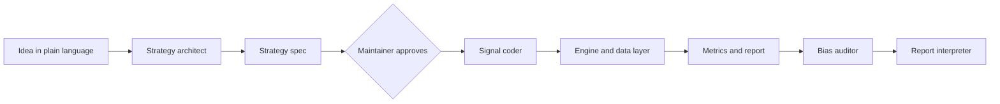

# Architecture

`backtest-agent` is a deterministic Python core (data, engine, metrics, reporting, journal) with Claude Code subagents
around it. The agents turn ideas into a strategy spec and a small signal function and review the results, but they
never write the engine. Status: the data layer is implemented (provider interface, yfinance provider, fake provider
and Parquet cache in Phase 1, data validation and data hash in Phase 2; see [data.md](data.md)), the strategy spec and
signal interface (Phase 3; see [strategy-spec.md](strategy-spec.md)) and the engine (Phase 4: the portfolio simulation and `run_backtest`, which loads data with warm-up, validates, hashes
and returns a `BacktestResult`; see [engine.md](engine.md)). Costs (commission, half-spread, slippage) are deducted by the engine (Phase 5; see [ADR 0010](adr/0010-cost-model.md)). Every other component below is **planned** and arrives in the phase named in the [roadmap](ROADMAP.md). For the reasons behind
the design see [adr/](adr/README.md).

## Components

| Component | Responsibility | Kind | Status |
|---|---|---|---|
| Strategy architect | Asks clarifying questions, writes the spec and a list of assumptions, never runs a backtest | Agent | Planned (Phase 10) |
| Signal coder | Writes the signal function and its tests, only under `strategies/` and tests | Agent | Planned (Phase 10) |
| Engine and data layer | Fetches and validates data, runs the backtest, computes metrics | Deterministic code | Data fetching, cache, validation and hash done (Phases 1 and 2); portfolio simulation, runner with warm-up and result object done (Phase 4); costs and the gross versus net result done (Phase 5); performance metrics and the benchmark comparison done (Phase 6, see [metrics.md](metrics.md)) |
| Bias auditor | Reviews spec, signal code and results in its own context | Agent | Planned (Phase 11) |
| Report interpreter | Writes an honest plain-language verdict | Agent | Planned (Phase 11) |

## One run

1. The maintainer describes an idea (`/backtest "<idea>"`, Phase 12).
2. The strategy architect writes a YAML spec and its assumptions.
3. **Approval gate:** nothing runs until the maintainer confirms the spec.
4. The signal coder writes the signal function against the fixed interface; an interface test must pass.
5. The data layer loads and validates prices and computes a data hash. History is loaded from `period.start` minus
   the warm-up of the signal (`StrategySpec.warmup_rows`) and the results are trimmed to the period (`run_backtest`,
   Phase 4; the `bt` command follows in Phase 9).
6. The engine shifts the signals by `delay_bars` (default 1), applies costs and produces equity curve, positions and
   trades; metrics are computed next to a buy-and-hold benchmark.
7. The journal stores the run (spec, data hash, code version, metrics) and increments the trial counter of the
   strategy family. `run_experiment` does steps 6 to 8 for a standard run: evaluate, log, then write the report with the
   trial line (see [journal.md](journal.md)).
8. The report is written, the bias auditor adds findings and the report interpreter adds the verdict.

The same steps run without any agent through the `bt` command (Phase 9).

## Building blocks

| Block | Responsibility | Where |
|---|---|---|
| Data layer | Provider interface, yfinance provider, fake provider, Parquet cache (Phase 1); validation, data hash (Phase 2) | `src/backtest_agent/data/` |
| Strategy spec | Pydantic schema for YAML specs, signal interface and registry, built-in signals, example specs (Phase 3; see [strategy-spec.md](strategy-spec.md)) | `src/backtest_agent/spec/`, `strategies/` |
| Engine | Daily bar loop with vector operations across symbols, long-only, multi-asset, execution delay, rebalancing; `run_backtest` and `BacktestResult`; costs and gross versus net (Phases 4 and 5, see [engine.md](engine.md)) | `src/backtest_agent/engine/` |
| Metrics | Performance and risk metrics and benchmark comparison with `evaluate` (Phase 6, see [metrics.md](metrics.md)) | `src/backtest_agent/metrics/` |
| Reporting | Markdown and HTML report with SVG charts, caveats and the trial line, see [report.md](report.md) | `src/backtest_agent/reporting/` |
| Journal | Run log, SQLite index and trial counter per strategy family (Phase 8, see [journal.md](journal.md)) | `src/backtest_agent/journal/` |
| Experiment | `run_experiment`: evaluate, log, report in one call (Phase 8) | `src/backtest_agent/experiment.py` |
| CLI | The `bt` command (planned, Phase 9) | `src/backtest_agent/cli.py` |
| Agents | Strategy architect, signal coder, bias auditor, report interpreter, `/backtest` command (planned, Phases 10 to 12) | `.claude/` |
| Robustness | Out-of-sample, walk-forward, sensitivity, regimes, look-ahead test, deflated Sharpe | `src/backtest_agent/robustness/` |

Besides `data/`, `spec/` and `engine/`, only empty packages exist today; `cli.py` and `.claude/` are created by the phase that
needs them. `strategies/` holds the example specs; agent-written signals will live there too (Phase 10).

## Data flow

Daily prices enter through a provider (first yfinance) as a standard frame with a date index and adjusted OHLCV, and
are cached as Parquet under `data/cache/` by `CachedProvider`, a wrapper that works with any provider (implemented,
see [data.md](data.md)). Validation attaches severities to its findings (errors stop a run, warnings go into the
report) and the data hash is the SHA-256 of the canonical frame (both implemented in Phase 2; the run pipeline that
calls them is `run_backtest`, Phase 4). The engine turns signals into positions and an equity
curve. A run leaves as a report under `reports/<run-id>/` and a journal entry under `runs/<run-id>/`. Data, runs and
reports are git-ignored and never committed.

## Trust boundaries

| Boundary | What enforces it |
|---|---|
| The LLM must not write or change the engine | Agent permissions allow writes only under `strategies/` and tests; the engine is covered by hand-calculated tests whose expected values are literals in [engine.md](engine.md) (active, Phase 4; agent permissions planned, Phase 10) |
| A strategy must not use future data | The spec rejects `delay_bars: 0` without an explicit `allow_same_bar_execution: true`, never allows an open fill on the signal bar, and reports same-bar execution as a risk flag (active, Phase 3); the signal contract demands causal signals and checks every signal output at run time (active, Phase 3); signals are shifted by `delay_bars` in the engine: an order executes on bar `t + delay_bars`, and a test shows that changing prices after a date leaves everything up to it unchanged (active, Phase 4: the simulation core and `run_backtest`, including a test that perturbs all prices after a date through the provider); an automated look-ahead test (planned, Phase 15) |
| A signal must not hand the engine bad values | `Signal.generate` checks input and output on every call: same index and columns, `float64`, within 0 and 1, no NaN (active, Phase 3) |
| Nothing runs without human approval | The approval gate in `/backtest` stops after the spec (planned, Phase 12) |
| Bad data must not produce a result | `validate_prices` reports data errors, warnings and infos with stable codes; `ValidationResult.raise_for_errors()` raises `DataValidationError`, and the run pipeline calls it before every run (mechanism done in Phase 2, wired into the run by `run_backtest` in Phase 4 and the CLI in Phase 9); the data hash ties a result to its exact data |
| Tests must not touch the network | A fake in-memory data provider, yfinance mocked in tests, the one live test marked `network` and excluded by default; CI runs without network access (active) |
| Market data, outputs and secrets must not be committed | `.gitignore` entries for `data/`, `runs/`, `reports/`, `*.parquet`, `.env`; PR checklist (active) |
| An overfitted result must not look like a real one | Trial counter in the journal and the trial line of the report (Phase 8, done); the deflated Sharpe ratio (planned, Phase 15) |
