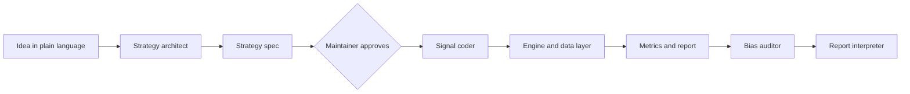

# Architecture

`backtest-agent` is a deterministic Python core (data, engine, metrics, reporting, journal) with Claude Code subagents
around it. The agents turn ideas into a strategy spec and a small signal function and review the results, but they
never write the engine. Status: only the package skeleton exists today (Phase 0); every component below is
**planned** and arrives in the phase named in the [roadmap](ROADMAP.md). For the reasons behind the design see
[adr/](adr/README.md).

## Components

| Component | Responsibility | Kind | Status |
|---|---|---|---|
| Strategy architect | Asks clarifying questions, writes the spec and a list of assumptions, never runs a backtest | Agent | Planned (Phase 10) |
| Signal coder | Writes the signal function and its tests, only under `strategies/` and tests | Agent | Planned (Phase 10) |
| Engine and data layer | Fetches and validates data, runs the backtest, computes metrics | Deterministic code | Planned (Phases 1 to 6) |
| Bias auditor | Reviews spec, signal code and results in its own context | Agent | Planned (Phase 11) |
| Report interpreter | Writes an honest plain-language verdict | Agent | Planned (Phase 11) |

## One run

1. The maintainer describes an idea (`/backtest "<idea>"`, Phase 12).
2. The strategy architect writes a YAML spec and its assumptions.
3. **Approval gate:** nothing runs until the maintainer confirms the spec.
4. The signal coder writes the signal function against the fixed interface; an interface test must pass.
5. The data layer loads and validates prices and computes a data hash.
6. The engine shifts the signals by `delay_bars` (default 1), applies costs and produces equity curve, positions and
   trades; metrics are computed next to a buy-and-hold benchmark.
7. The journal stores the run (spec, data hash, code version, metrics) and increments the trial counter of the
   strategy family.
8. The report is written, the bias auditor adds findings and the report interpreter adds the verdict.

The same steps run without any agent through the `bt` command (Phase 9).

## Building blocks

| Block | Responsibility | Where |
|---|---|---|
| Data layer | Provider interface, yfinance provider, Parquet cache, validation, data hash | `src/backtest_agent/data/` |
| Strategy spec | Pydantic schema for YAML specs, signal interface, example strategies | `src/backtest_agent/spec/`, `strategies/` |
| Engine | Vectorized daily backtest, long-only, multi-asset, costs and slippage | `src/backtest_agent/engine/` |
| Metrics | Performance and risk metrics, benchmark comparison | `src/backtest_agent/metrics/` |
| Reporting | Markdown and HTML reports with charts and caveats | `src/backtest_agent/reporting/` |
| Journal | Run log with trial counter per strategy family | `src/backtest_agent/journal/` |
| CLI | The `bt` command (planned, Phase 9) | `src/backtest_agent/cli.py` |
| Agents | Strategy architect, signal coder, bias auditor, report interpreter, `/backtest` command (planned, Phases 10 to 12) | `.claude/` |
| Robustness | Out-of-sample, walk-forward, sensitivity, regimes, look-ahead test, deflated Sharpe | `src/backtest_agent/robustness/` |

Only the empty packages exist today; `strategies/`, `cli.py` and `.claude/` are created by the phase that needs them.

## Data flow

Daily prices enter through a provider (first yfinance) as a standard frame with a date index and adjusted OHLCV, and
are cached as Parquet under `data/cache/` (planned). Validation attaches severities (errors stop a run, warnings go
into the report) and a SHA-256 hash of the canonical frame. The engine turns signals into positions and an equity
curve. A run leaves as a report under `reports/<run-id>/` and a journal entry under `runs/<run-id>/`. Data, runs and
reports are git-ignored and never committed.

## Trust boundaries

| Boundary | What enforces it |
|---|---|
| The LLM must not write or change the engine | Agent permissions allow writes only under `strategies/` and tests; the engine is covered by hand-calculated tests (planned, Phases 4 and 10) |
| A strategy must not use future data | Signals are shifted by at least one bar; `delay_bars: 0` needs an explicit opt-out that the report flags; an automated look-ahead test (planned, Phases 3 and 15) |
| Nothing runs without human approval | The approval gate in `/backtest` stops after the spec (planned, Phase 12) |
| Tests must not touch the network | A fake in-memory data provider; CI runs without network access (planned, Phase 1) |
| Market data, outputs and secrets must not be committed | `.gitignore` entries for `data/`, `runs/`, `reports/`, `*.parquet`, `.env`; PR checklist (active) |
| An overfitted result must not look like a real one | Trial counter in the journal and the deflated Sharpe ratio (planned, Phases 8 and 15) |
